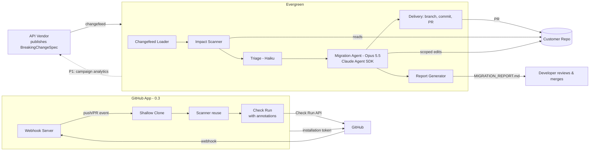

# Architecture
## Evergreen -- Self-Maintaining APIs
**Version:** 1.0 | **Date:** 2026-11-13 | **Status:** Draft -- living document
**Doc ID:** ARCH | Upstream: [FSD.md](FSD.md) | Detail: [SYSTEM_DESIGN.md](SYSTEM_DESIGN.md)

---

## 1. System Context



**CLI flow (0.1-0.2):** a spec comes in -> deterministic scanner finds candidate sites -> (optional) cheap LLM triage discards false positives -> Opus-class agent edits only the affected files under a minimal-diff contract -> changes land on an isolated branch with a manifest + evidence report -> human merges.

**GitHub App flow (0.3):** push/PR event arrives -> shallow clone via installation token -> scanner runs all bundled specs -> findings posted as GitHub Check Run annotations on the commit -- read-only, no code changes.

---

## 2. Component Overview

| Component | FR | Responsibility | MVP form |
|---|---|---|---|
| Changefeed Loader | FR-01 | Parse + validate BreakingChangeSpec | `src/changefeed/` |
| Repo Targeter | FR-02 | Resolve target, enforce git safety | `src/repo/` |
| Impact Scanner | FR-03 | Deterministic pattern pass -> Findings | `src/scanner/` |
| Triage | FR-03.2 | Haiku pass: affected / not / uncertain | `src/triage/` (flag-gated) |
| Migration Agent | FR-04 | Claude Agent SDK session, minimal-diff edits, manifest | `src/migrator/` |
| Orchestrator | FR-04/05 | Pipeline, branch isolation, revert-on-failure, confidence gating | `src/orchestrator.ts` |
| Delivery | FR-05 | Branch, commit, (P1: PR) | `src/delivery/` |
| Report Generator | FR-06 | MIGRATION_REPORT.md + JSON | `src/report/` |
| CLI | FR-07 | Commands, flags, config | `src/cli.ts` |
| Webhook Server | FR-08.2 | Express HTTP, webhook signature verification, async dispatch | `src/server/app.ts` |
| Webhook Handlers | FR-08.2/4 | Event -> clone -> scan -> alert pipeline | `src/server/webhooks.ts` |
| GitHub Client | FR-08.1/3/5 | App auth, installation tokens, shallow clone, Check Runs | `src/github/` |
| Spec Registry | FR-08.4 | Load + cache all bundled specs from `specs/` | `src/registry/specs.ts` |

---

## 3. Key Architectural Decisions (ADR summary -- log lives in CONTEXT.md)

| ADR | Decision | Rationale | Alternatives rejected |
|---|---|---|---|
| ADR-1 | TypeScript / Node ≥20 | GitHub-ecosystem native (Octokit/Probot path), same language as target wedge (JS/TS repos), Claude Agent SDK first-class | Python (fine, but GitHub App ecosystem weaker) |
| ADR-2 | Claude **Agent SDK** as migration engine, not a hand-rolled tool loop | Codebase mutation is exactly the Claude Code harness (read/edit/grep tools, context mgmt). Hand-rolling buys nothing in MVP | Raw Messages API + Tool Runner (more control, more code -- revisit if we need custom sandboxing) |
| ADR-3 | Deterministic scan **before** agent | 100-1000× cost reduction; bounded token spend; auditable scope ("agent may only touch these files") | Agent-explores-whole-repo (expensive, unscoped, unauditable) |
| ADR-4 | `claude-opus-5-5` for migration, `claude-haiku-5-5` for triage | Opus: correctness-critical edits, default per claude-api guidance ($4/$20). Haiku: binary classification at $0.10/$0.50 | Single-model everything (either too costly or too weak) |
| ADR-5 | Branch isolation + manifest-or-revert | A half-migrated tree is worse than no migration; trust is the product | Edit in place on current branch |
| ADR-6 | Open JSON changefeed spec | Ecosystem/network effects; vendors author specs; registry later | Proprietary format |
| ADR-7 | Local-first CLI MVP, GitHub App later | Prove the loop with zero infra; CLI is also the on-prem enterprise story later | Hosted-first (slow to demo, infra drag) |
| ADR-8 | Express + `@octokit/webhooks` for GitHub App server | Battle-tested in GitHub App ecosystem (Probot DNA); webhook signature verification built-in; installation token management via `@octokit/auth-app` | Hono (lighter but weaker Octokit integration), Probot framework (too opinionated, masks GitHub API) |
| ADR-9 | Check Runs for alerts (not Issues or PR comments) | Best UX: inline annotations on the exact lines in the PR diff; structured conclusion/summary; no notification spam; idempotent re-runs | Issues (too noisy, no inline context), PR comments (no structured conclusion, accumulate on re-push) |
| ADR-10 | Shallow clone for repo access (not GitHub Contents API) | Scanner needs full file enumeration + line-by-line regex; Contents API is per-file (N+1 problem); shallow clone is one `git clone --depth 1` | Contents API (too many requests), full clone (wasteful) |

---

## 4. Trust & Security Boundaries

```
┌────────────────────────────── customer machine / CI ─────────────────────────────┐
│  CLI + Orchestrator (trusted)                                                     │
│  ┌──────────────┐   findings    ┌─────────────────────────────┐                  │
│  │   Scanner    │ ────────────► │  Agent session (constrained) │                  │
│  │ (no network) │               │  tools: read/edit/grep only  │                  │
│  └──────────────┘               │  cwd-jailed to target repo   │                  │
│                                 └──────────────┬──────────────┘                  │
│        repo content (scoped files only) ───────┼──► Anthropic API (TLS)          │
│        spec file (untrusted input: validated)  │                                  │
└────────────────────────────────────────────────┼─────────────────────────────────┘
                                                 ▼
                                   never: push, merge, network tools, bash
```

- **Specs are untrusted input** -- validated structurally; regex patterns compiled in a try/catch; guidance text reaches the agent as *data within a frame that names it as vendor-supplied content*, and the agent's tool surface (no bash, no network) bounds the blast radius of a malicious spec.
- **Repo content is untrusted** -- only ever data; the agent cannot execute it (no bash in MVP); `verifyCommand` is run by the orchestrator and comes from the *repo owner's own* `.evergreen.json`, never from the spec.
- Least privilege everywhere: scan = read-only; migrate = writes on its own branch only.

---

## 5. Deployment Topology

**MVP (now):** single CLI binary (`npx evergreen`), everything local. Anthropic API is the only remote dependency.

**v1 (GitHub App):**
```
GitHub webhooks ─► API service (spec registry + campaign mgmt)
                       │ enqueue (repo × spec)
                       ▼
                 job queue ─► worker pool (clone -> scan -> migrate -> PR)
                       │
                       ▼
                 Postgres (vendors, specs, repos, runs, manifests) + object store (reports)
```
Workers run the exact same orchestrator module as the CLI -- **one pipeline, two shells** (CLI shell and worker shell). This is the central code-structure constraint: nothing in `src/` outside `cli.ts` may read `process.argv` or assume a TTY.

**Enterprise (later):** self-hosted worker image (repos never leave customer VPC), control plane stays hosted.

---

## 6. Scaling Path & Cost Envelope
- Unit of work = (repo × spec). Embarrassingly parallel; queue + stateless workers scale linearly.
- Token budget per run enforced by scanner scoping; projected COGS ~$1.35/migration (BRD §5.3), logged per-run (NFR-6).
- Vendor campaign of 10K repos ≈ $13.5K COGS against $50K-500K contract -- margin holds at scale.

---

## 7. What We Deliberately Did Not Build (MVP)
- AST-level codemods (regex + LLM semantic pass is the 80/20; AST backends per language are a P2 quality lever, pluggable behind the Scanner interface).
- Sandboxed execution of customer tests in hosted mode (P1 concern; MVP runs locally where the user already trusts their own code).
- Multi-language. The **spec format** is language-agnostic; the MVP scanner/agent target JS/TS.
